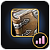

# MySpells

**See exactly what each of your spells is doing: damage, healing and shields, ability by ability, in a clean Details-style window.**

On WoW Forever, the combat log is closed to addons, and with it went the classic *"My Spells"* view that damage meters used to offer. MySpells brings it back. It reads the game's own built-in damage meter, the same source Details uses on this client, and shows every one of your abilities as a bar with its total and its share of the whole.

---

## Installation

1. Download the latest release (or this repository as a ZIP).
2. Put the `MySpells` folder in your WoW Forever AddOns folder:
   `World of Warcraft\_forever_\Interface\AddOns\MySpells`
3. Restart the game or type `/reload`, and make sure **MySpells** is enabled in the AddOns list at character select.

---

## Features

### Three modes
Switch with the sword icon on the title bar, or right-click anywhere on the window:

- **Damage Done**: damage per ability, pets included.
- **Healing Done**: effective healing per spell, on yourself and on others. Overhealing is not counted.
- **Damage Prevented**: how much damage each of your shields absorbed, plus an estimate for your percent damage reductions, worked out from the damage you took and how long each one was up:
  - Warrior: Defensive Stance
  - Paladin: Improved Righteous Fury, Iron Creed
  - Priest: Shadowform, Spell Warding
  - Shaman: Elemental Warding
  - Warlock: Soul Link, Molten Skin, Master Demonologist (Voidwalker or Felhunter)

### Every fight, not just the last one
The page icon opens a list of your recent fights, named by the game (usually the enemy or encounter), each with its duration. Pick **Current fight**, **Overall**, or any past fight. Right-click the icon to step through them.

### Report to chat
A report window modeled on Details' *Link Details!*:
- Send to **Party, Raid, Guild, Officer, Whisper, Whisper Target, Say**, any chat channel you've joined, or a Battle.net friend.
- Choose **1–25 lines**, optionally **reversed**.
- Numbers line up neatly in chat.
- **Copy & Paste** gives you the report as text instead.

### Looks right next to Details
- Details' *Minimalistic* look: dark title bar with rounded corners, translucent body, class-colored bars.
- Uses Details' own fonts, bar textures and toolbar icons when Details is installed.
- Title bar icons and the resize corner stay hidden until you hover over the window, keeping it clean.
- Resize the window by dragging the bottom-right corner.

### Fully customizable
A gear menu with two tabs, modeled on Details' options:

- **Bars:** window background color and opacity, right-click menu and minimap button on/off, font, size, outline, shadow, text color or class color, rank numbers, what the right side shows (total, per second, percent), bracket and separator style, per-second decimals, bar height and spacing.
- **Title Bar:** font, size, outline, shadow, color, show/hide the total, background color and opacity, title bar height, icon size and spacing, hover-only icons.

Every change applies instantly, and each tab has its own reset button.

### Minimap button
Click the MySpells logo on your minimap to show or hide the window, right-click it for the settings, and drag it anywhere around the minimap's edge. You can hide it in the settings or with `/myspells minimap`.

### Reset
One click clears all fight data, the same as Details' reset button.

---

## Commands

| Command | What it does |
|---|---|
| `/myspells` or `/mys` | Show or hide the window |
| `/myspells options` | Open the settings |
| `/myspells current` / `overall` | Switch segment |
| `/myspells rows <2-40>` | Set the window height in rows |
| `/myspells lock` | Lock or unlock the window |
| `/myspells reset` | Reset the window's size and position |
| `/myspells minimap` | Show or hide the minimap button |
| `/myspells reductions` | List the damage reductions MySpells sees for your class |

---

## Requirements

- **WoW Forever.** MySpells reads the client's built-in damage meter.
- **No other addons are required.**
  - **Details!** is optional. When installed, MySpells borrows its artwork so the two match. Without it, MySpells uses standard game textures and works exactly the same.
  - Fonts from **SharedMedia** and similar addons appear in the font list automatically.

---

## Good to know

- **During combat the game hides some numbers from addons.** Bars and totals still update live, but percentages may only fill in, and abilities may only sort biggest-first, once the fight ends. Reports wait until after combat for the same reason.
- **The damage meter is shared with Details**, so the reset button clears Details' data too (and vice versa).
- **The game decides how many past fights it keeps.** A past fight disappears from the list once the game drops it.

---

## Credits

Talent and spell values for the damage reduction estimates come from [Talents Forever](https://talentsforever.com) (CC BY 4.0).
